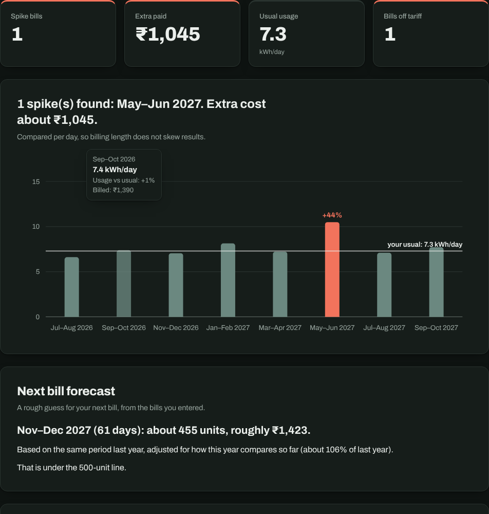
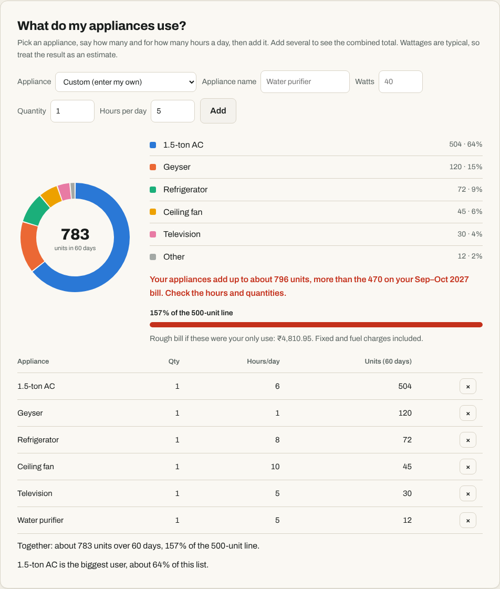
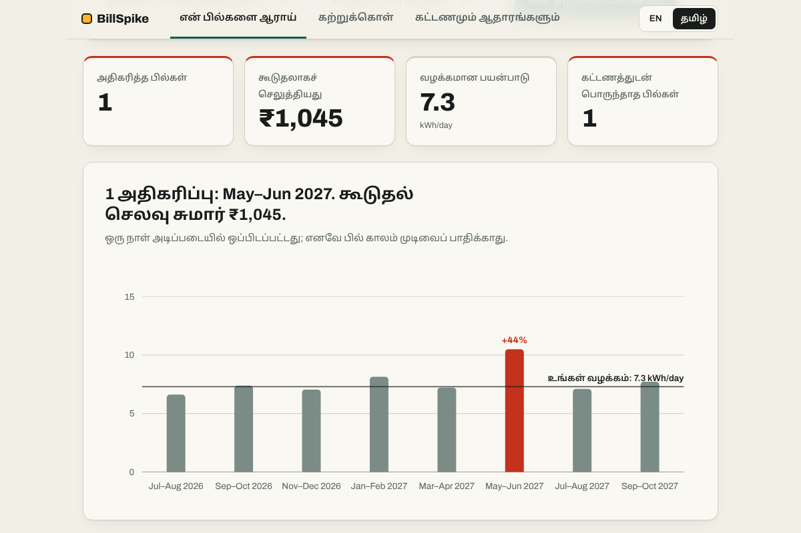

# BillSpike: Tamil Nadu electricity bill analyzer

[](https://github.com/moniishh17/electricity-bill-spike-analyzer/actions/workflows/test.yml)

**Live demo: https://moniishh17.github.io/electricity-bill-spike-analyzer/**

Enter your bi-monthly TNPDCL bills and find out which ones were unusually high, what the tariff says each should have cost, and where your units are going. Available in English and Tamil. It runs entirely in the browser, with no backend, build step or dependencies, and nothing you enter is uploaded.



| Appliance breakdown | Tamil interface |
|---|---|
|  |  |

## What it does
- **Finds spikes.** Median and MAD robust statistics flag unusual bills, comparing per day so a 62-day bill is not mistaken for a spike.
- **Audits each bill against the tariff.** Telescopic LT-IA slabs, fixed charge by connected load, an indicative fuel surcharge and the 500-unit cliff where the free allowance drops from 200 to 100 units. Large gaps between billed and calculated amounts are flagged. Dated tariffs are matched to each bill's period; bills the tool cannot check are marked "not audited" rather than guessed.
- **Forecasts the next bill** from the same period last year, scaled by this year's trend, or from your last normal bills when history is short. Each bill is also compared with a year earlier.
- **Breaks down appliances.** Pick from 16 common Indian appliances or add your own (name and watts) to see a donut of where units go, a meter against the 500-unit line, and a check against your real bill's units.
- **Cliff Guard** projects the current cycle and gives a daily unit budget to stay under 500.
- **Guides first-time users:** a six-step walkthrough, plain-language explainers, and a slab-by-slab bill calculator.
- **English and Tamil** across the whole page, with a first-visit language prompt. A test fails if any text lacks a Tamil translation.
- Structured bill entry with From/To month dropdowns and automatic day counts, CSV import and export, saved between visits, light and dark themes, keyboard accessible, reduced-motion friendly, and user text is never inserted as HTML.

## Input format
```
period,units,amount,days
Jan–Feb,410,1700,59
```
Units per bi-monthly bill, amount in rupees, days optional. See `data/sample.csv`.

## Accuracy and data sources
Tariffs live in `js/tariff.js` as a dated list: the 1 July 2024 order (100 free units, one ladder) and the 10 May 2026 scheme (200 free units at or below 500 bi-monthly units). Rates come from public reports and calculators, **not the official TNERC order**, so check them against your bill. Domestic bills are treated as exempt from electricity duty; arrears and late fees are not modelled. Appliance wattages are typical values, not measurements, and results are estimates. The Tamil text is a translation that should be reviewed by a native speaker.

## Run it
```
npm start        # serves the folder (ES modules need http, not file://)
npm test         # unit tests with Node's built-in test runner
```
Deploy: repository Settings, then Pages, then deploy from `main`.

## Project structure
```
index.html          page shell
css/styles.css      theme tokens and layout
css/fonts.css       self-hosted font faces
fonts/              Archivo, Noto Sans Tamil, DM Mono (SIL Open Font License)
js/parser.js        CSV to rows and errors
js/analysis.js      spike statistics (pure functions)
js/tariff.js        dated TN tariffs, fixed charge, fuel surcharge, 500-unit cliff
js/usage.js         year-on-year comparison and next-bill forecast
js/planner.js       Cliff Guard cycle projection
js/learn.js         bill calculator, appliance estimator and donut data
js/insights.js      analysis to plain-language checks with severity
js/chart.js         SVG bar, tariff-curve and donut charts with tooltips
js/period.js        month labels and day counts
js/tabs.js          Analyze / Learn / Tariff tabs
js/i18n.js          language switching; js/lang-ta.js holds the Tamil text
js/main.js          wires the UI together
tests/              unit tests (analysis, tariff, usage, i18n coverage and more)
data/sample.csv     demo data
docs/screenshots/   images used in this README
```

## How detection works
For each bill, `z = 0.6745 × (value − median) / MAD`. A bill is a spike when `z > 2` and it is at least 20% above the median. Median and MAD are used instead of mean and standard deviation because a large outlier inflates the latter and hides itself.

## Ideas to extend
Read bill PDFs, verify tariffs against the official order, support other states' slabs.

## License
MIT, see `LICENSE`.
